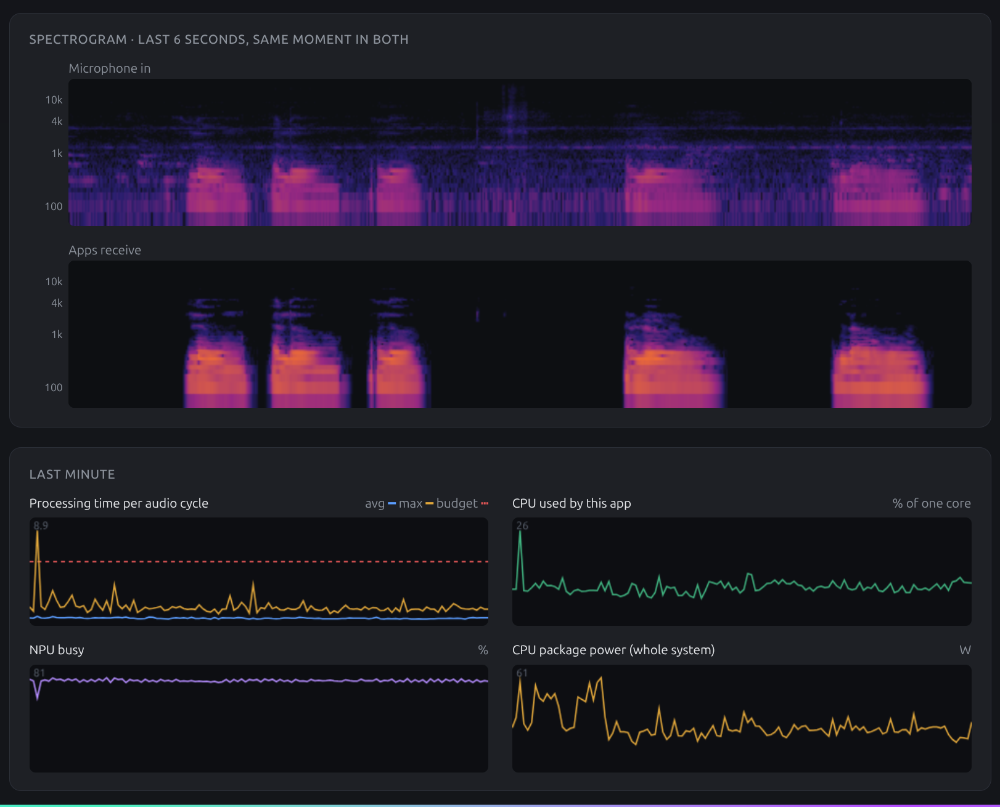

# npumic

Real-time microphone noise removal and voice isolation on the Intel NPU for Linux.

`npumic` creates a PipeWire virtual microphone called **NPU Denoised Mic** that you can select in Zoom, Meet, Slack, Discord, Firefox, or OBS. It runs the heavy neural network inference on the Intel NPU via OpenVINO, keeping CPU usage low and leaving your GPU asleep.



## What it does

Audio runs at 48 kHz in 10 ms blocks through three stages:

1. **Automatic mic level** — tracks your active speaking level and adjusts gain so your voice reaches apps at -24 dBFS. If your physical mic clips at full scale, `ClipGuard` automatically lowers the hardware input volume in PipeWire.
2. **Noise removal (DPDFNet-2 48 kHz)** — full-band (0–24 kHz) deep filtering on the NPU. Log-magnitude and deep-filter magnitude features are cut out of the ONNX graph at load time and computed in FP32 on the CPU before feeding the NPU. This avoids FP16 underflow on the NPU and keeps high frequencies (6–24 kHz) crisp.
3. **Keep only my voice (VoxLock)** — optional target-speaker voice isolation on the NPU. You record a 10-second sample of your voice once per microphone. When turned on, it removes other people talking in the background.

If your machine has no Intel NPU or a model fails to run on it, that stage falls back to the CPU automatically without dropping audio.

## How the service behaves

- **Idle until used** — the physical microphone is unlinked and no models run while no app is recording from **NPU Denoised Mic**. This leaves your mic, the NPU, and Bluetooth headsets (which drop to low-quality call profiles when their mic is open) completely untouched when you are not in a call.
- **Automatic mic priority** — uses the microphone you picked if connected; otherwise prefers USB, then Bluetooth, then built-in. When you plug in or unplug a headset during a call, it switches the input behind the scenes while apps stay connected to **NPU Denoised Mic**.
- **Default input** — sets **NPU Denoised Mic** as the system default input when started and restores your previous default when stopped.
- **Zero-drift live audio** — runs as a single PipeWire JACK client (`npumic_engine`) where input and output share the same real-time callback and clock cycle.

## Requirements

- Linux with PipeWire, WirePlumber (`wpctl`), and PipeWire's JACK library (`pipewire-jack`)
- Python 3.12+ and [`uv`](https://docs.astral.sh/uv/)
- Intel NPU driver (`intel-level-zero-npu` / `/dev/accel/accel0`) for NPU acceleration (falls back to CPU if not present)

On Ubuntu / Debian:

```bash
sudo apt install pipewire wireplumber pipewire-audio-client-libraries pipewire-jack libsndfile1
```

## Install

```bash
git clone https://github.com/anwar3606/npumic.git
cd npumic
uv sync
uv run npumic install
```

`uv run npumic install` does three things:

1. Downloads and verifies the ONNX models from Hugging Face into `models/` (~53 MB total, Apache-2.0 licensed: [DPDFNet-2 48 kHz](https://huggingface.co/Ceva-IP/DPDFNet) and [VoxLock](https://huggingface.co/arbazsiddiqui/voxlock)).
2. Installs and starts the `npumic.service` systemd user unit so it starts automatically on login.
3. Installs and enables the GNOME Shell Quick Settings extension (`npumic@anwar3606.github.io`, GNOME 46–52). Log out and back in once for GNOME Shell to load the new extension.

To remove the service and GNOME extension:

```bash
uv run npumic uninstall
```

## Usage

### GNOME Quick Settings

Click the **NPU Mic** toggle in GNOME Quick Settings to start or stop the service. Open its arrow menu to:

- Toggle **Noise removal**, **Keep only my voice**, and **Automatic mic level**
- Record your 10-second voice sample for **Keep only my voice**
- See which app is using the mic, current processing delay, and any warnings
- Open the live debug page or service log

### Command line

```bash
uv run npumic status --events            # check state, active apps, devices, and recent events
journalctl --user -u npumic -f           # follow the service log
systemctl --user restart npumic          # restart the background service
```

You can also run it directly in the foreground without installing the service:

```bash
uv run npumic run
uv run npumic run --mic headset --no-default
```

### Debug web page

While `npumic` is running, open [http://127.0.0.1:5057/](http://127.0.0.1:5057/) in your browser.

It shows live input and output level meters, time-aligned input/output spectrograms, processing time per audio cycle, CPU usage, NPU busy percentage (`npu_busy_time_us`), and system package power (RAPL). Nothing is sampled for the debug page until you open it.

## Voice isolation ("Keep only my voice")

VoxLock isolates your voice from other speakers in the room. Before turning it on:

1. Click **Record** under *Other people's voices* on the debug page (or **Record voice sample** in the GNOME menu).
2. Talk normally, alone, for 10 seconds.
3. `npumic` saves the cleanest 3-second segment for that microphone in `data/voices/` and enables the toggle.

Voice isolation adds 96.5 ms of processing latency when enabled (0 ms when off).

## Models I tried

Before settling on DPDFNet-2 and VoxLock, I tried every streaming speech model I could find on the NPU. All numbers were measured on an Intel Core Ultra 7 255HX (Arrow Lake NPU) laptop with an NVIDIA RTX 5060 Laptop GPU. Each model had to keep up with live audio, sound better in blind listening tests, and use little power. The full measurements, charts and dead ends are in [docs/RESEARCH.md](docs/RESEARCH.md).

### Noise removal

| Model | Ran on | What happened | Result |
| --- | --- | --- | --- |
| **[DPDFNet-2 48 kHz](https://huggingface.co/Ceva-IP/DPDFNet)** | NPU, CPU, NVIDIA | Full band (0–24 kHz). 4.7 ms per 10 ms step on the NPU, about 1 ms on the CPU. At first the NPU version sounded muffled above 6 kHz because the model's input features underflowed in FP16; computing them in FP32 on the CPU fixed it. | **Used** (default) |
| [DPDFNet-8 48 kHz](https://huggingface.co/Ceva-IP/DPDFNet) | CPU, NPU, NVIDIA | Larger version (3.6M parameters), only slightly better (+0.1–0.3 dB SI-SDR). 13.5 ms per 10 ms step on the NPU, too slow for live audio. Ran well on the GPU (2.9 ms), but the GPU then draws about 30 W. | Dropped |
| [GTCRN](https://github.com/Xiaobin-Rong/gtcrn) | NPU, CPU | Tiny (23.7K parameters, 523 KB). 1.9 ms per 16 ms step on the NPU, with identical output on the NPU and the CPU. 16 kHz only, so nothing above 8 kHz. | Default for a while, replaced by DPDFNet-2 |
| [UL-UNAS](https://github.com/Xiaobin-Rong/ul-unas) | NPU, CPU | 16 kHz. 4.1 ms per 16 ms step on the NPU. Had the same FP16 feature problem as DPDFNet, fixed the same way. Sounded the worst in listening tests. | Dropped |
| [DTLN](https://github.com/breizhn/DTLN) | NPU | 0.79 ms per 8 ms frame on the NPU. Used in the first proof of concept only. | Dropped |
| [DeepFilterNet3](https://github.com/Rikorose/DeepFilterNet) | CPU | 1.2 ms per 10 ms step on the CPU. The streaming ONNX version doesn't compile for the NPU because its graph has dynamic parts (`If`, `NonZero`). An unlicensed community split did run on the NPU (about 4.4 ms per step) but couldn't be shipped. | Dropped |
| [Intel `noise-suppression-denseunet-ll-0001`](https://github.com/openvinotoolkit/open_model_zoo/tree/master/models/intel/noise-suppression-denseunet-ll-0001) | NPU | Compiles, but every inference fails. It breaks once its saved state passes about 3.1 MB, which looks like an NPU runtime limit. 16 kHz only. | Dropped |

### Voice isolation and speaker recognition

| Model | Ran on | What happened | Result |
| --- | --- | --- | --- |
| **[VoxLock](https://huggingface.co/arbazsiddiqui/voxlock)** | NPU, CPU, NVIDIA | Keeps only the enrolled speaker. 14.4 ms per 40 ms call on the NPU, 96.5 ms total delay. | **Used** |
| [Hush](https://huggingface.co/weya-ai/hush) | CPU, NPU | DeepFilterNet3 retrained to also remove background voices, without a voice sample. 0.55 ms per 10 ms step on the CPU, 12.5 ms delay. On the NPU it had to wait behind DPDFNet and caused glitches (394 late audio cycles in 6 s). | Dropped |
| [WeSpeaker](https://github.com/wenet-e2e/wespeaker) ResNet34 | NPU | Voice fingerprint model: 2.3 ms per second of audio on the NPU. The proof of concept used voice fingerprints to mute other speakers. | Replaced by VoxLock |
| [3D-Speaker](https://github.com/modelscope/3D-Speaker) ERes2Net | NPU | Voice fingerprint model: 4.0 ms per second of audio on the NPU. | Replaced by VoxLock |
| CAM++ ([3D-Speaker](https://github.com/modelscope/3D-Speaker)) | NPU | Doesn't compile for the NPU (unsupported pooling padding). | Dropped |
| TF-GridNet ([ESPnet](https://github.com/espnet/espnet)), SepFormer ([SpeechBrain](https://github.com/speechbrain/speechbrain)) | CPU, NPU | Need 2–8 s of audio at once: 1.3 s per run on the CPU, and the NPU compiler runs out of memory. Not usable live. | Dropped |

### What I learned about the NPU

- **It computes in FP16 only.** Log and power features underflow and voices lose their high frequencies. Cutting those steps out of the ONNX graph and computing them in FP32 on the CPU made NPU output match CPU output.
- **It runs one job at a time.** With two models on the NPU, a noise-removal step that arrives during a VoxLock call has to wait. Giving VoxLock fewer, larger calls (5 frames instead of 3) cut late audio cycles from 811 to 53 in 4 minutes.
- **Calls must be pipelined.** Waiting for the NPU inside the audio callback missed deadlines. Starting step *n* and collecting step *n−1* adds one step of delay but keeps the callback under 0.3 ms.
- **The GPU works, but costs power.** Both models ran on the RTX 5060 with no glitches, but the GPU stayed at full clock and about 30 W, so the NVIDIA support was removed.

## Tests

```bash
uv run pytest                            # unit and model tests (CPU + NPU)
uv run pytest -m live                    # end-to-end PipeWire tests (stop npumic.service first)
```

## License

Code is licensed under the [MIT License](LICENSE). The automatically downloaded pre-trained models ([DPDFNet](https://huggingface.co/Ceva-IP/DPDFNet) and [VoxLock](https://huggingface.co/arbazsiddiqui/voxlock)) are licensed under Apache-2.0 by their respective authors.

