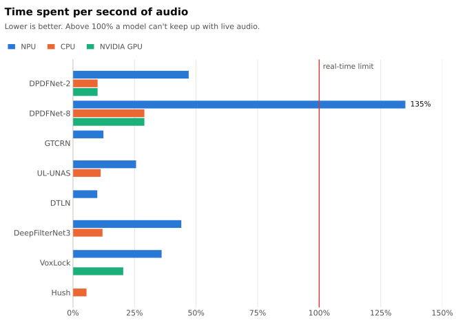
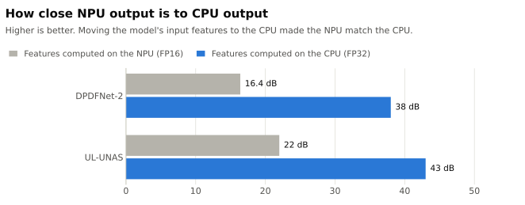
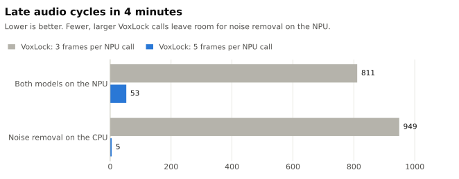

# Research notes

How npumic ended up running DPDFNet-2 and VoxLock on the Intel NPU: the models I tried, what I measured, and the problems I hit along the way.

## The short version

1. **Small speech models run fine on the NPU.** Most use under half of the real-time budget. Only the largest one I tried, DPDFNet-8, couldn't keep up. → [Picking a model](#1-picking-a-model)
2. **The NPU only computes in FP16, and that broke voice quality.** Computing the model's input features on the CPU fixed it. → [FP16](#2-the-npu-only-computes-in-fp16)
3. **Quiet microphones confused the noise model,** so npumic sets the mic level first. → [Quiet microphones](#3-quiet-microphones)
4. **Real-time audio is unforgiving.** Waiting for the NPU, OpenVINO's thread pool and even OpenVINO's telemetry each broke the audio. → [Staying on time](#4-keeping-the-audio-on-time)
5. **The NPU runs one job at a time,** so two models on it must take turns. → [Sharing the NPU](#5-two-models-one-npu)
6. **The GPU worked, but cost about 30 W.** So npumic is NPU-only. → [Why not the GPU](#6-why-not-the-gpu)
7. **Listening tests beat scores.** An automatic quality score preferred a broken chain over raw audio. → [How changes were judged](#8-how-changes-were-judged)
8. **The best existing tool, NVIDIA Broadcast, doesn't work here.** It's Windows only, and its Linux SDK is for licensed datacenter GPUs. → [Considered but not used](#10-considered-but-not-used)

## Test setup

| | |
| --- | --- |
| Laptop | Intel Core Ultra 7 255HX (Arrow Lake NPU), NVIDIA RTX 5060 Laptop GPU |
| Runtimes | OpenVINO on the NPU and CPU, ONNX Runtime with CUDA on the GPU |
| Audio | 48 kHz, processed in 10 ms blocks |
| Deadline | PipeWire calls the audio callback every 256 samples, so each callback has **5.3 ms** |

---

## 1. Picking a model

**The goal:** a model that processes audio faster than it arrives, on the NPU. The chart shows the time each model needs per second of audio. Above 100% it falls behind.

<picture>
  <source media="(prefers-color-scheme: dark)" srcset="images/speed-dark.svg">
  
</picture>

**What stands out:**

- Every model measured on both was **slower on the NPU than on the CPU**. That's fine: the NPU's job is to take the work off the CPU at low power, not to be fastest.
- **DPDFNet-8** is the only model too slow for live audio on the NPU (135%).
- The CPU numbers use **one inference thread**. That was twice as fast as OpenVINO's default thread pool for DPDFNet-2 (0.9 ms vs 1.8 ms), and it avoided a freeze ([section 4](#4-keeping-the-audio-on-time)).
- The GPU numbers use **CUDA graphs**. Without them each step is dominated by kernel launches: DPDFNet-8 took 9.5 ms per 10 ms step.

| Model | Audio per step | NPU | CPU | NVIDIA GPU |
| --- | --- | --- | --- | --- |
| DPDFNet-2 48 kHz | 10 ms | 4.7 ms (47%) | 1.0 ms (10%) | 1.0 ms (10%) |
| DPDFNet-8 48 kHz | 10 ms | 13.5 ms (135%) | 2.9 ms (29%) | 2.9 ms (29%) |
| GTCRN | 16 ms | 1.98 ms (12%) | | |
| UL-UNAS | 16 ms | 4.1 ms (26%) | 1.8 ms (11%) | |
| DTLN | 8 ms | 0.79 ms (10%) | | |
| DeepFilterNet3 | 10 ms | 4.4 ms (44%)¹ | 1.2 ms (12%) | |
| VoxLock | 40 ms (NPU), 24 ms (GPU) | 14.4 ms (36%) | | 4.9 ms (20%) |
| Hush | 10 ms | | 0.55 ms (6%) | |

¹ An unlicensed community split of the model. The official streaming ONNX doesn't compile for the NPU.

## 2. The NPU only computes in FP16

**Problem.** DPDFNet-2 on the NPU sounded muffled. It lost 11–16 dB more than the CPU above 6 kHz. Raising the input level didn't help, so the level wasn't the cause.

**Cause.** The model computes its own input features inside the graph (power, `log10`, square root). In FP16, `10·log10(|X| + 1e-10)` breaks, because `1e-10` rounds to zero.

**Fix.** When the model loads, npumic cuts those steps out of the graph and computes them in FP32 with NumPy on the CPU. The NPU runs the rest, including the model's running normalizations.

**Result.** NPU output now matches CPU output, and the 12–24 kHz band is the same on both.

<picture>
  <source media="(prefers-color-scheme: dark)" srcset="images/fp16-dark.svg">
  
</picture>

| Model | NPU vs CPU difference, features on the NPU | Features on the CPU |
| --- | --- | --- |
| DPDFNet-2 | −16.4 dB | −38.0 dB |
| UL-UNAS | −22 dB | −43 dB |

**Also worth knowing:**

- UL-UNAS had the same problem in its log-magnitude feature, and the same fix worked.
- Asking the NPU compiler to run selected layers at higher precision either failed to compile or made the output worse.
- GTCRN didn't need the fix: its output was identical on the NPU and the CPU.

## 3. Quiet microphones

**Problem.** DPDFNet-2 removed speech as if it were noise when speech peaks were below about −30 dBFS. Before the FP16 fix, the NPU cut a third of the speech peaks in one of my meeting recordings.

**After the FP16 fix,** the NPU and CPU behave the same. A USB-C headset recording had no speech dropouts even at −60 dBFS. Microphones still vary a lot, so npumic sets the level before the model.

**How automatic level works:**

| | |
| --- | --- |
| Target | Apps receive speech at about −24 dBFS |
| Where | One gain before noise removal, kept in the output |
| When it moves | Only while you speak (12 dB above the tracked noise floor) |
| How fast | Up 3 dB/s (10 dB/s during the first 3 s of speech), down 6 dB/s |
| Range | −12 to +30 dB |
| Clipping | If over 0.1% of samples hit full scale in 0.5 s, npumic lowers the mic's system input volume |

The clipping guard is there because of the built-in mic. At 100% it adds +60 dB of gain (two +30 dB ALSA controls) and clipped on room hum alone.

**Result.** On my recordings every voice clip landed at −23.5 to −25.5 dBFS, and DNSMOS rose by 0.2–0.5 on headset clips. Noise-only clips stayed at 0 dB gain.

## 4. Keeping the audio on time

Each audio callback has 5.3 ms. Three things made it miss that deadline:

| Problem | What happened | Fix | Result |
| --- | --- | --- | --- |
| Waiting for the NPU | Calling the NPU and waiting took 3.0 ms on average, up to 13 ms. 233 late cycles in 2.5 s. | Start the NPU on block *n*, collect block *n−1* | 0.2–0.3 ms in the callback, no late cycles, one step more delay |
| OpenVINO's CPU thread pool | CPU inference from the callback froze the whole process. No traceback; even `SIGTERM` didn't work. The callback waited on worker threads it starved. | One inference thread, no CPU pinning | 30 of 30 live runs clean, and twice as fast |
| OpenVINO telemetry | `import openvino` forks a telemetry sender. That risks a deadlock in a multi-threaded audio process, and sends data off the machine. | Block the telemetry module before importing OpenVINO | No forked process, nothing sent |

## 5. Two models, one NPU

**Problem.** With noise removal and VoxLock both on the NPU, the audio glitched.

**Cause.** The NPU processes one request at a time. A noise-removal step submitted during a VoxLock call finished late, and the callback waited for it.

**Fix.** VoxLock processes 8 ms frames. Sending it 5 frames per call instead of 3 means fewer, longer calls, with more room for noise removal in between.

| VoxLock frames per call | NPU time per call | Share of the NPU |
| --- | --- | --- |
| 3 | 12.4 ms every 24 ms | 52% (about 99% together with noise removal) |
| 5 | 14.4 ms every 40 ms | 36% |

**Result.** Late cycles dropped by over 90%:

<picture>
  <source media="(prefers-color-scheme: dark)" srcset="images/queue-dark.svg">
  
</picture>

| Setup | 3 frames per call | 5 frames per call |
| --- | --- | --- |
| Both models on the NPU | 811 | 53 |
| Noise removal on the CPU | 949 | 5 |

**The trade-offs:**

- VoxLock's delay went from 72.5 ms to 96.5 ms.
- Asking PipeWire for longer cycles (512 samples) made things worse. One callback then sometimes had to process two blocks, and the second waited on the first one's NPU result.
- Live, with both models on, the NPU is about 71% busy and its clock moves between 733 and 1600 MHz.

## 6. Why not the GPU

Everything also ran on the RTX 5060. DPDFNet-8 and VoxLock together took 0.2 ms on average in the callback, with no late cycles. But the GPU then stays at full clock, around **30 W and 45% load**, for a job the NPU does at a fraction of that. That's why npumic is NPU-only.

Making the GPU work at all took effort:

| Problem | Fix |
| --- | --- |
| Loading CUDA in the audio process held Python's interpreter lock for 47 ms, and closing a session took 108 ms. Both stalled the audio. | Run GPU models in a helper process that exchanges a few kB per step over a socket pair |
| After the models were released, the CUDA context kept 228 MiB and the GPU awake | End the helper process when the GPU is turned off |
| Even with no GPU models, asking OpenVINO which devices exist loads every plugin. Its GPU plugin opened the NVIDIA card through OpenCL and kept it awake at about 4 W for as long as the service ran. | Check each device through its own plugin only |

## 7. Linux audio gotchas

| Problem | Fix |
| --- | --- |
| `pw-record \| python \| pw-play` dropped 3–13% of samples, even with prefill and a shared clock | One JACK client through PipeWire's `libjack`, with input and output in the same callback. Passthrough is sample-exact. |
| A `support.null-audio-sink` with `media.class=Audio/Source` never gets its ports configured, and stalls every node created after it | Use `media.class=Audio/Source/Virtual` for the virtual microphone |
| WirePlumber ignores a stream's target when the target is a source, and sends the stream to the speakers | Create streams unconnected and link them explicitly |
| WirePlumber restores per-app volumes, so a test stream came back at −6 dB | Set `state.restore-props=false` on npumic's streams |
| `wpctl set-default` refuses virtual sources | Write `default.configured.audio.source` with `pw-metadata`. Apps that follow the default then move to the virtual mic. |

## 8. How changes were judged

Automatic scores weren't enough: DNSMOS rated an early, broken chain (clipped, +88 dB of gain) higher than unprocessed audio. So every change had to pass two gates:

1. **Artifact checks** on synthetic and real recordings: dropouts, clipping, and a detector for audio that's discontinuous at the 10 ms block boundaries.
2. **A blind A/B listening test.** A change that scored well but sounded worse was rejected.

The listening tests made several decisions: UL-UNAS was dropped, GTCRN was the default for a while, and DPDFNet-2 on the NPU replaced it once the FP16 fix was in.

## 9. Dead ends

| What I tried | Why it didn't work |
| --- | --- |
| The first proof of concept: noise removal, dereverberation, EQ, level control and speaker gating, chained | Each piece worked alone. Together they produced noise from per-block resampling, mismatched hop sizes, an unwindowed per-block FFT, and an EQ that boosted 20–70 dB. I rebuilt from scratch with one 48 kHz / 10 ms block contract, adding stages one at a time. |
| Intel `noise-suppression-denseunet-ll-0001` | Compiles for the NPU, but every inference fails. Any subset of its outputs works until the saved state passes about 3.1 MB, which points to an NPU runtime limit. |
| DeepFilterNet3 | Its streaming ONNX has dynamic parts (`If`, `NonZero`) the NPU compiler rejects. Intel's OpenVINO version is fixed to 30 s inputs, so it only works offline. |
| CAM++ | The NPU compiler fails on an unsupported pooling padding mode. |
| TF-GridNet and SepFormer | They separate speakers well, but need 2–8 s of audio at once: 1.3 s per run on the CPU, and the NPU compiler runs out of memory. |
| Hush on the NPU | It waited behind DPDFNet's calls: 394 late cycles in 6 s. |

## 10. Considered but not used

These never ran in npumic. I looked into each one and stopped before testing. Status is as of October 2026.

### NVIDIA

The obvious answer to "clean up my mic with AI" is NVIDIA Broadcast. It works well, but not on Linux.

| Option | What it is | Why not |
| --- | --- | --- |
| [NVIDIA Broadcast](https://www.nvidia.com/en-us/geforce/broadcasting/broadcast-app/) | NVIDIA's free noise removal app for RTX cards | Windows only. |
| [NVIDIA Audio Effects SDK](https://docs.nvidia.com/maxine/afx/latest/LinuxAFXSDK/GetStartedOnLinux.html) (Maxine) | The models behind Broadcast, for developers: noise removal, room echo removal, Studio Voice, and Speaker Focus (keeps only the main speaker) | The Windows SDK targets desktop apps, but the Linux SDK is built for datacenter and cloud servers, and NVIDIA doesn't support it anywhere else. The download sits behind an NGC subscription, and [NVIDIA staff said](https://forums.developer.nvidia.com/t/impossible-to-download-maxine-audio-effects-sdk/343193) an NVIDIA AI Enterprise license is required (downloads return "402 Payment Required"). Even with access, it would keep the GPU awake during every call. |

### Voice isolation models

Before VoxLock, I looked for an open, live "keep only my voice" model:

| Option | What it is | Why not |
| --- | --- | --- |
| [REAL-TSE](https://real-tse.github.io/challenge) online models | Streaming voice isolation from a 2026 research challenge, trained on real meeting and dinner-party recordings | The models were only available to registered challenge teams. Converted baselines have appeared since, but without a clear license. |
| [OpenSpeakerBeam-SS](https://github.com/helloooideeeeea/OpenSpeakerBeam-SS) | An independent reimplementation of SpeakerBeam-SS, a real-time voice isolation model | Its author describes the quality as "modest". |
| [D-LGTSE](https://github.com/isHuangZiling/D-LGTSE) | Voice isolation guided by GTCRN noise removal | Processes whole recordings, not live audio. |

### Other noise removal

| Option | What it is | Why not |
| --- | --- | --- |
| Windows Studio Effects "Voice Focus", Krisp | NPU and CPU noise removal products | Closed products, not downloadable models. Windows Studio Effects is Windows only. |
| [Intel PoCoNet](https://github.com/openvinotoolkit/open_model_zoo/tree/master/models/intel/noise-suppression-poconetlike-0001) (Model Zoo) | Intel's other ready-made noise removal model | 16 kHz only, the same limit as GTCRN. Its sibling DenseUNet already failed on the NPU. |
| [Intel DeepFilterNet for OpenVINO](https://huggingface.co/Intel/deepfilternet-openvino) | Intel's conversion of DeepFilterNet 2 and 3 | Fixed to 30 s inputs, so offline only (see [Dead ends](#9-dead-ends)). |
| Retraining DPDFNet to cope with FP16, on the RTX 5060 | Fine-tune the existing weights with FP16 rounding simulated during training | Ceva published the model but [not how it was trained for low precision](https://github.com/ceva-ip/DPDFNet/issues/18). It would need hundreds of GB of training data and days of work, with no guarantee the GPU's FP16 matches the NPU's. Moving the input features to the CPU ([section 2](#2-the-npu-only-computes-in-fp16)) fixed the problem without any retraining. |

---

The charts are generated from the numbers above:

```bash
uv run --with matplotlib python docs/charts.py
```
